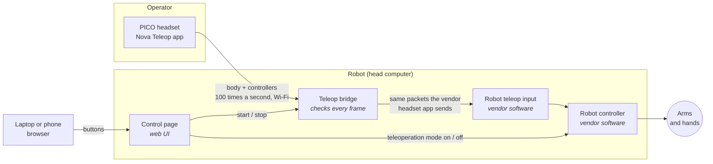
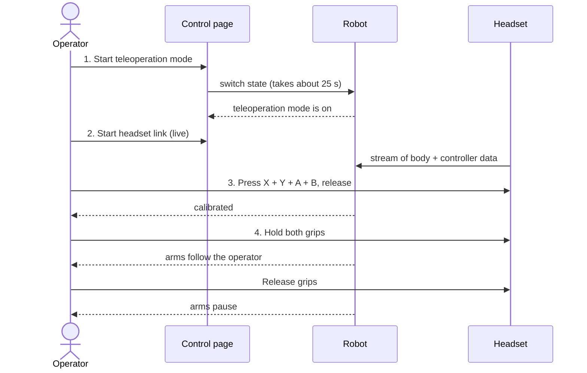
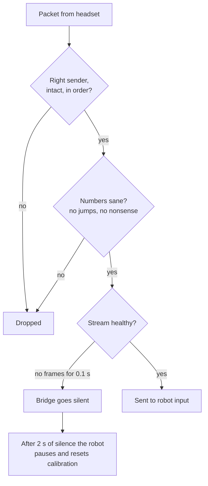
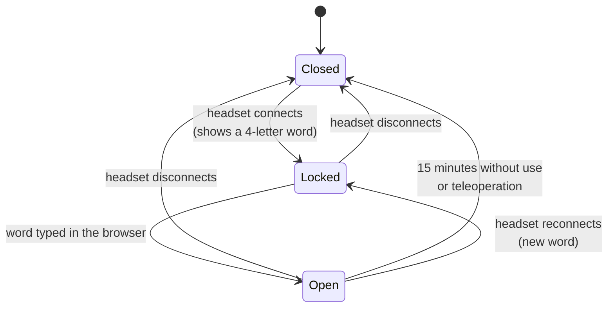
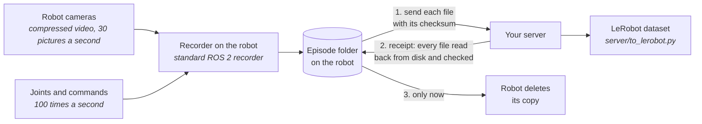
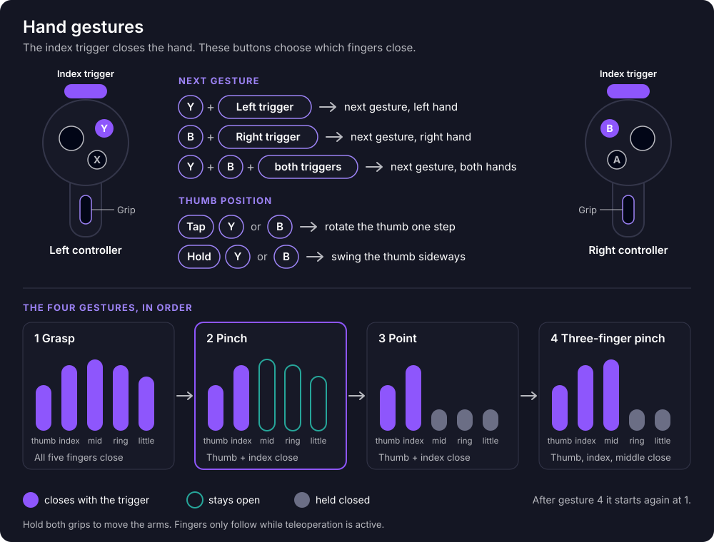

# nova_teleop_bridge

Move an **AgiBot A3** humanoid robot with your own body, using a **PICO 4** headset and its
two controllers.

This repository is the part that runs **on the robot**. The headset app (Nova Teleop) lives
in its own repository.

> **Status, honestly.** An operator has teleoperated a real A3 with this software, and a recorded
> episode has travelled from the robot to a server and been checked there. Depth pictures and
> the conversion to a LeRobot dataset are **not** done.
> See [What is proven and what is not](#what-is-proven-and-what-is-not).

---

## The idea in one picture



In plain words:

1. The **headset** measures where your head, hands and body are, and reads the controller
   buttons. It sends this to the robot 100 times a second.
2. The **bridge** on the robot checks each message. Broken, late or impossible messages are
   thrown away. Good ones are rewritten into the exact packet the robot already understands.
3. The **robot's own teleop software** does the rest: it decides when you are in control,
   calibrates to your body and moves the arms. We do not replace it.
4. The **control page** is a small website on the robot. You use it to switch the robot into
   teleoperation mode and to start the bridge.

## How a session goes



| You do | The robot does |
|---|---|
| Press **X + Y + A + B** together, then release | Calibrates to your pose |
| **Hold both grips** | Follows your arms. Let go and it pauses |
| **Click both thumbsticks** | Emergency stop |
| Nothing arrives for 2 seconds | Pauses by itself and wants a new calibration |

These button rules belong to the robot's own software, not to this project.

## Quick start

Everything needs only Python 3 from the standard install. Nothing to `pip install`.

**1. Run the tests** (any computer, no robot needed):

```bash
python3 -m unittest discover -s tests
```

**2. Start the control page on the robot:**

```bash
python3 robot/teleop_service.py
```

It waits for the headset. When Nova Teleop on the headset connects, the headset shows a
four-letter word and the page opens at `http://<robot address>:8090/`. Type the word to unlock
it. To start it with the robot, see `deploy/nova-teleop.service`.

No headset at hand? `python3 tools/session_hello.py --word TEST` on the robot opens the page
the same way.

**3. Or run the bridge by hand:**

```bash
python3 robot/teleop_bridge.py
```

That is **test mode**: it listens to the headset and checks the stream, but sends nothing to
the robot. Add `--robot-input` to go live.

## Safety

The bridge is built so that **doing nothing is always the fallback**.



- **Test mode is the default.** Going live needs an explicit switch (`--robot-input`) or the
  *Start live* button, which asks first.
- **One headset only.** The first valid sender is locked in; others are ignored.
- **Bad data is dropped**, never repaired: damaged packets, repeats, out-of-order packets,
  impossible positions, sudden jumps.
- **Silence means stop.** When the stream stops, the bridge sends nothing. It never repeats
  old data and never invents a "release" message. The robot notices the silence and pauses.
- **Buttons are never made up.** Triggers and grips are only limited to their valid range.
- **The control page is closed most of the time** and needs the word from the headset. This
  keeps casual visitors out. It is not strong security and nothing is encrypted, so use it only
  on a network you trust.
- Keep the **emergency stop** in reach, and keep people out of reach of the arms.

## The control page

`robot/teleop_service.py` serves one page (`web/index.html`), but only while a headset is
connected:



- The word is picked by the headset, new for every connection.
- Five wrong words in a row pause the lock for 30 seconds.
- Teleoperating counts as use: the page never idles out while the headset is streaming. If it
  did close for idleness, it comes back with the same word when that headset streams again.
- When the connection is closed in the headset, the live link stops and the robot leaves
  teleoperation mode (this can be switched off in Settings).
- While the service runs, the bridge stays in **test mode** so the headset can find the robot.
  *Go live* on the page switches it to live; *Back to test mode* switches it back.

What is on the page:

- **Robot** – current state and whether the robot's three computers answer.
- **Start teleoperation** – the three steps above, with live numbers for the headset stream.
- **Record episodes** – start and stop a recording, and see what is waiting for upload.
- **Settings** – which headset to accept, and settings for data collection.

## Recording episodes for training

One **episode** is one attempt at a task. Three actions on the control page control it, each
with a button and a key:

| Action | Key | Sound | What happens |
|---|---|---|---|
| Start recording | F8 | one high tone | A new episode begins |
| Stop and keep | F9 | two rising tones | The episode is closed and queued for upload |
| Delete episode | F10 | one long low tone | The episode being recorded, or else the last one, is thrown away |

Three short low tones mean "that did not work" (for example *start* while already recording).
Closing the connection in the headset also ends the episode.

**Foot pedal.** Give each pedal one of the keys in the pedal's own software (for an Elgato
pedal: a *Hotkey* action per pedal). The keys can be changed in Settings. They only work while
the control page is the active browser window, so click the page once before you start.

**Delete is careful.** One press deletes one episode and a second press does nothing, so the
episode before can never be lost by accident. An episode that already reached the server is
not erased there: the server moves it to its `discarded` folder.



**What is in an episode**

| File | What it is |
|---|---|
| `bag/*.mcap` | Every message exactly as the robot published it, with its type and the time it arrived. MCAP is the standard ROS 2 recording format. |
| `episode.json` | Task, operator, start and end time, number of messages per stream, warnings, robot state, bridge settings |
| `record.log` | What the recorder printed |
| `manifest.json` | Size and SHA-256 checksum of each file |

Raw data comes first: nothing is re-encoded, resampled or reformatted on the robot. The video
stays in the camera program's own H.265 stream, and each video message keeps the camera's own
timestamp.

**What is recorded today** (see `config/recording.json`): the compressed video of the chest
and waist cameras, the joint states and joint commands of arms, hands, waist, neck and legs,
and the operator input as the robot received it. This is about 1.2 MB per second.

**The right armpit camera is switched off by default.** Its complete pictures (key frames)
are too large to reach the head computer intact, so most of them are lost and the video in
between cannot be decoded. It can be switched on in Settings, but expect unusable video.

**What is not recorded: depth.** On the A3 the depth pictures cannot be received on the head
computer where this service runs. Worse, merely listening for them makes the robot's own
camera video drop to under one picture a second. The recorder therefore refuses raw camera
topics in its configuration. Wrist cameras are prepared as a setting and need cameras fitted.

**Looking after the robot's disk**

- An episode is deleted on the robot only after the server's receipt lists every file with the
  right size and checksum. Any doubt, and it stays and the upload is tried again.
- Recording does not start when free space is below the limit in Settings, and stops by itself
  when space runs low or the temporary storage limit is reached.
- A half-written episode (power cut) is never uploaded and never deleted automatically.

**Lost pictures.** Video travels inside the robot without a delivery guarantee, and now and
then a picture is lost on the way to the recorder. The pictures after it, up to the camera's
next key frame (at most one second for chest and waist), cannot be decoded correctly. The raw
episode keeps exactly what arrived; the converter below reports every such loss.

**The server side** is one file with no dependencies:

```bash
python3 server/ingest_server.py --root ~/nova_teleop_data --token <a secret of your choice>
```

Put the server's address (`http://<server>:8095`) and the same secret into Settings on the
control page. Episodes land in `<root>/episodes/<episode>/` with a `receipt.json` next to them.
The link is not encrypted: use it on a network you trust.

## Making a LeRobot dataset

On the server, `server/to_lerobot.py` builds a LeRobot dataset (format v2.1) from the stored
episodes. The episodes themselves are never changed, so the dataset can be rebuilt at any time
with other choices.

```bash
pip install -r server/requirements.txt      # numpy, pyarrow, mcap, mcap-ros2-support; also needs ffmpeg
python3 server/to_lerobot.py --out ~/nova_teleop_data/lerobot/my_task --cameras chest_front_d457,waist_front_d415
```

A LeRobot dataset is one table with one row per video picture, while the robot's streams each
run on their own clock. The converter therefore decides, and writes into
`conversion_report.json`, the following:

| Question | Answer |
|---|---|
| When does an episode start? | When every chosen camera has delivered a complete picture and joint data exists |
| Which picture belongs to a row? | The one closest in time, from each camera |
| Which joint reading is the state? | The newest one at or before the row's time, never a later one |
| What is the action? | The newest joint command at or before the row's time. Without recorded commands: the next row's state, and the report says so |
| What if pictures were lost? | The rows repeat the last good picture. If more than 1.1 s in a row is affected, the episode is left out |
| Which episodes are used? | Those with a receipt and without recording warnings. Deleted episodes are not in the folder any more |

State and action hold arms, hands, waist and neck (39 values), named after the robot's joints.
Arm, waist and neck values are in radians; the hand values are the hand motors' own units
(0 to 4095). Velocity and effort are stored as extra columns.

## Fingers

The robot's own hand program closes the fingers with the index trigger and offers four
gestures. For "only two fingers, the rest open", step once to **Pinch**. This project does not
replace that; the control page shows the same guide.



The guide is taken from the robot's configuration and vendor notes.

## What is inside

| Path | What it is |
|---|---|
| `robot/teleop_service.py` | Control page server |
| `web/index.html` | The control page |
| `web/gestures.svg` | Picture guide to the hand gestures |
| `robot/data_collection.py` | Episode recording, upload, and delete-after-receipt |
| `server/ingest_server.py` | Runs on your server: receives episodes and proves they are stored intact |
| `server/to_lerobot.py` | Runs on your server: builds a LeRobot dataset from stored episodes |
| `config/recording.json` | Which streams one episode records |
| `robot/session.py` | The headset's small "hello / goodbye" message that opens and closes the page |
| `deploy/nova-teleop.service` | Start the service together with the robot (optional) |
| `robot/teleop_bridge.py` | Bridge program: headset stream in, robot packets out |
| `robot/bridge_core.py` | All checks and conversions, no network code (easy to test) |
| `robot/a3_proto.py` | Writes and reads the robot's message formats by hand |
| `robot/discovery.py` | Lets the headset app find the robot on the network |
| `teleop_common/` | Headset-to-bridge packet format, coordinate maths |
| `config/transform.json` | Every assumption about axes, scale and origin, in one file |
| `tools/static_pose_test.py` | Sends a still pose with tiny, slow hand moves for a first careful test |
| `tools/pcap_to_cap.py` | Turns a network capture into a test file |
| `pc/` | Optional sender for a PC running XRoboToolkit (an alternative to the headset app) |
| `tests/` | 170+ tests; none of them touch a real robot |
| `docs/` | Details: [packet format](docs/WIRE_FORMAT.md), [discovery](docs/DISCOVERY.md), [frame analysis](docs/A3_FRAME_ANALYSIS.md) |

## The packets, briefly

**Headset to bridge** (`NTB1`, UDP port 39500): one small binary packet per frame with a
sequence number, a checksum, head and controller poses, buttons and 24 body joints. Details in
[docs/WIRE_FORMAT.md](docs/WIRE_FORMAT.md).

**Bridge to robot** (UDP port 25618 on the robot itself): one `RobotFrameData` message per
packet, the same message the vendor's headset app sends. It holds:

- a timestamp in milliseconds and a frame counter,
- 24 body joints, each with a position and an orientation,
- three devices (left controller, right controller, head), each with buttons and a pose.

Orientations are packed into 32 bits. The exact layout is documented at the top of the
`RobotFrameData` section in [`robot/a3_proto.py`](robot/a3_proto.py). The robot drops packets
that repeat a timestamp, so the bridge makes sure timestamps always rise.

Positions use: **x forward, y left, z up, in metres**, measured from the operator's own head
and turned so that the operator faces forward. This reference is taken when the stream starts
and **again every time X + Y + A + B is pressed with both grips released**, so calibrating
also tells the bridge "this is where I stand and which way I face now".

A second live mode, `--publish`, writes straight to the robot's internal ROS 2 topics instead.
It skips the robot's input program and with it the button rules above, so it is not the
recommended path.

## What is proven and what is not

| | |
|---|---|
| ✅ | The robot packet writer reproduces 8,766 recorded packets of the vendor headset app **byte for byte** |
| ✅ | The whole chain works on one machine: fake headset → bridge → stand-in robot listener |
| ✅ | The control page reads the real robot's state; its buttons are tested against a stand-in robot |
| ✅ | Checks, watchdog and sender lock are covered by tests |
| ✅ | An operator has teleoperated the real robot through the bridge (arms and hands) |
| ✅ | A real 20-second episode (camera video at 30 pictures a second, joints at 100 a second) was recorded, uploaded, checked on the server and then deleted on the robot |
| ❌ | The axis mapping between the headset app and the robot (`config/transform.json`) is still marked provisional |
| ❌ | Depth pictures: not reachable on the robot's head computer |
| ✅ | That episode converts to a LeRobot v2.1 dataset: the table reads back, and each video has exactly one picture per row |
| ❌ | The dataset has not been loaded with the LeRobot library itself yet |
| ❌ | Recording while teleoperating has not been tried yet, only with the robot standing still. Whether the command streams fill is therefore unconfirmed |
| ❌ | The hotkeys and sound cues have not been tried in a browser yet, and no pedal was connected |
| ❌ | The right armpit camera cannot be recorded in usable quality |
| ❌ | Wrist cameras: none fitted yet |

## First test on a real robot

1. Robot hung up or otherwise safe, nobody within reach of the arms, emergency stop in hand.
2. Connect in the headset, unlock the page. All three computers green, then
   **Start teleoperation mode**.
3. Check the stream is healthy at about 100 frames a second (the link starts in test mode).
4. **Go live**. Calibrate. Hold both grips briefly and watch one small movement.
5. Release the grips. Then **Leave teleoperation mode**.

For an even more careful first step, `tools/static_pose_test.py` sends a fixed pose and moves
one hand by a few centimetres at most.

## Test files that are not in git

Two kinds of test data are recordings of vendor software and are kept out of the repository:
`tests/data/pico_sample_*.cap` and `tests/data/genielink_sample.cap`. Tests that need them are
skipped when they are missing. `tools/pcap_to_cap.py` makes the second one from your own
network capture.

## Notes

- This is an independent project. It is not made or endorsed by AgiBot or PICO.
- The robot's message formats were worked out from our own robot for interoperability. They
  may change with robot software updates.
