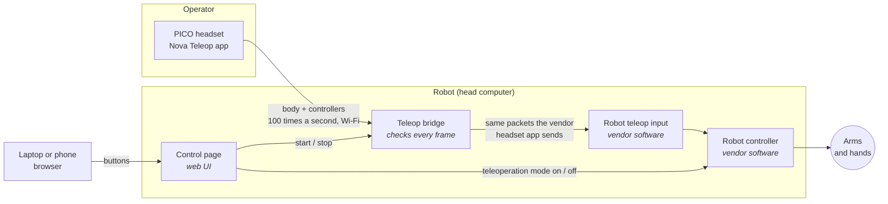
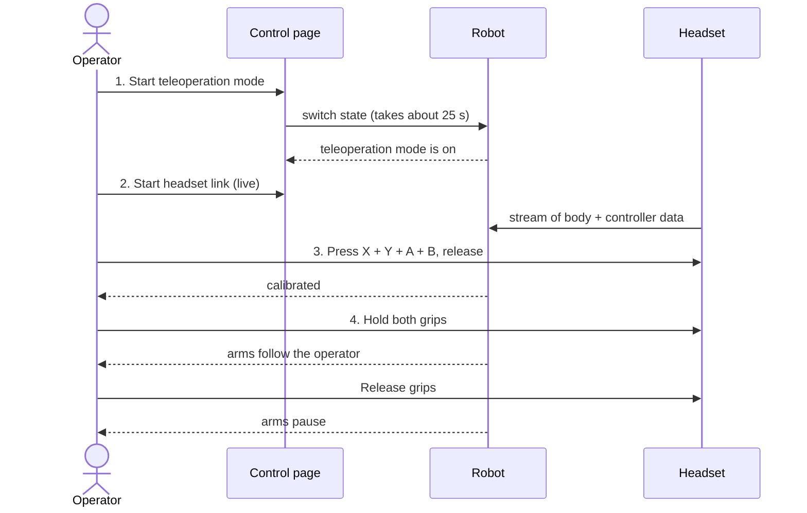
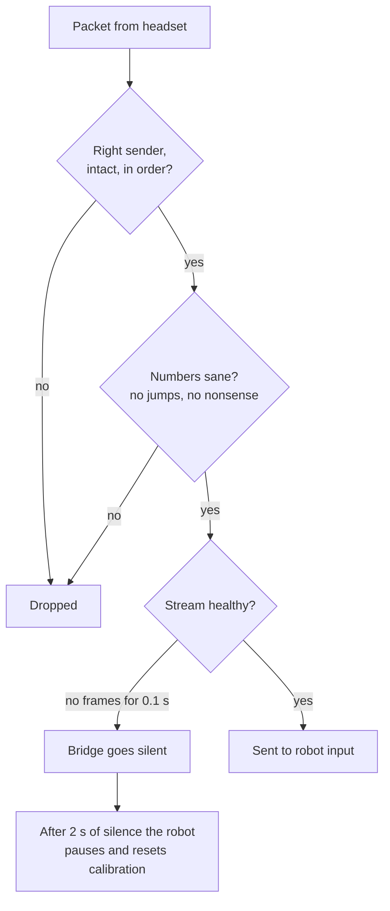
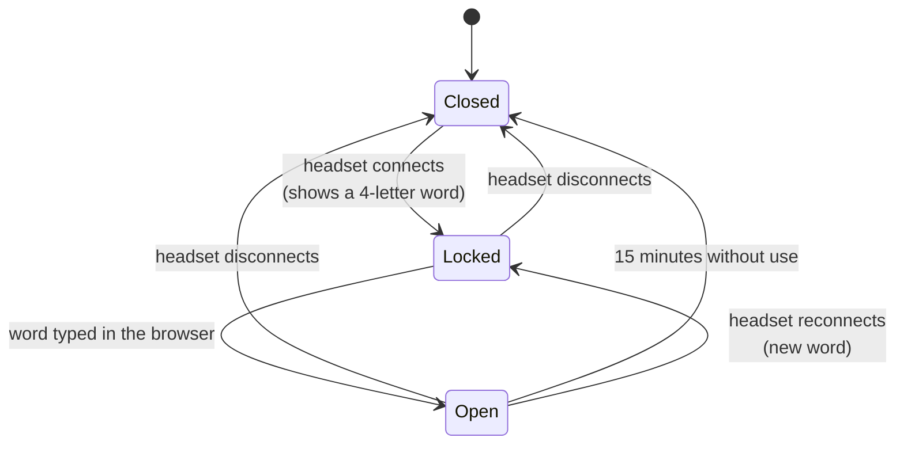
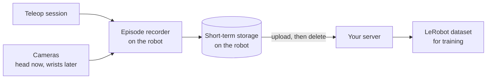

# nova_teleop_bridge

Move an **AgiBot A3** humanoid robot with your own body, using a **PICO 4** headset and its
two controllers.

This repository is the part that runs **on the robot**. The headset app (Nova Teleop) lives
in its own repository.

> **Status, honestly.** The software passes its tests and the packet format matches recorded
> traffic of the vendor's headset app byte for byte. It has **not yet moved the real robot**.
> See [What is proven and what is not](#what-is-proven-and-what-is-not).

---

## The idea in one picture



In plain words:

1. The **headset** measures where your head, hands and body are, and reads the controller
   buttons. It sends this to the robot 100 times a second.
2. The **bridge** on the robot checks each message. Broken, late or impossible messages are
   thrown away. Good ones are rewritten into the exact packet the robot already understands.
3. The **robot's own teleop software** does the rest: it decides when you are in control,
   calibrates to your body and moves the arms. We do not replace it.
4. The **control page** is a small website on the robot. You use it to switch the robot into
   teleoperation mode and to start the bridge.

## How a session goes



| You do | The robot does |
|---|---|
| Press **X + Y + A + B** together, then release | Calibrates to your pose |
| **Hold both grips** | Follows your arms. Let go and it pauses |
| **Click both thumbsticks** | Emergency stop |
| Nothing arrives for 2 seconds | Pauses by itself and wants a new calibration |

These button rules belong to the robot's own software, not to this project.

## Quick start

Everything needs only Python 3 from the standard install. Nothing to `pip install`.

**1. Run the tests** (any computer, no robot needed):

```bash
python3 -m unittest discover -s tests
```

**2. Start the control page on the robot:**

```bash
python3 robot/teleop_service.py
```

It waits for the headset. When Nova Teleop on the headset connects, the headset shows a
four-letter word and the page opens at `http://<robot address>:8090/`. Type the word to unlock
it. To start it with the robot, see `deploy/nova-teleop.service`.

No headset at hand? `python3 tools/session_hello.py --word TEST` on the robot opens the page
the same way.

**3. Or run the bridge by hand:**

```bash
python3 robot/teleop_bridge.py
```

That is **test mode**: it listens to the headset and checks the stream, but sends nothing to
the robot. Add `--robot-input` to go live.

## Safety

The bridge is built so that **doing nothing is always the fallback**.



- **Test mode is the default.** Going live needs an explicit switch (`--robot-input`) or the
  *Start live* button, which asks first.
- **One headset only.** The first valid sender is locked in; others are ignored.
- **Bad data is dropped**, never repaired: damaged packets, repeats, out-of-order packets,
  impossible positions, sudden jumps.
- **Silence means stop.** When the stream stops, the bridge sends nothing. It never repeats
  old data and never invents a "release" message. The robot notices the silence and pauses.
- **Buttons are never made up.** Triggers and grips are only limited to their valid range.
- **The control page is closed most of the time** and needs the word from the headset. This
  keeps casual visitors out. It is not strong security and nothing is encrypted, so use it only
  on a network you trust.
- Keep the **emergency stop** in reach, and keep people out of reach of the arms.

## The control page

`robot/teleop_service.py` serves one page (`web/index.html`), but only while a headset is
connected:



- The word is picked by the headset, new for every connection.
- Five wrong words in a row pause the lock for 30 seconds.
- Closing the page does **not** change what the robot is doing. Reconnect in the headset to
  get the page back.
- While the service runs, the bridge stays in **test mode** so the headset can find the robot.
  *Go live* on the page switches it to live; *Back to test mode* switches it back.

What is on the page:

- **Robot** – current state and whether the robot's three computers answer.
- **Start teleoperation** – the three steps above, with live numbers for the headset stream.
- **Settings** – which headset to accept, and settings for data collection.

**Data collection is not built yet.** The settings are saved so the page is ready, but nothing
is recorded or uploaded today. The plan:



Two upload choices are foreseen: convert to the LeRobot format on the robot, or upload the
raw recording and convert on the server.

## What is inside

| Path | What it is |
|---|---|
| `robot/teleop_service.py` | Control page server |
| `web/index.html` | The control page |
| `robot/session.py` | The headset's small "hello / goodbye" message that opens and closes the page |
| `deploy/nova-teleop.service` | Start the service together with the robot (optional) |
| `robot/teleop_bridge.py` | Bridge program: headset stream in, robot packets out |
| `robot/bridge_core.py` | All checks and conversions, no network code (easy to test) |
| `robot/a3_proto.py` | Writes and reads the robot's message formats by hand |
| `robot/discovery.py` | Lets the headset app find the robot on the network |
| `teleop_common/` | Headset-to-bridge packet format, coordinate maths |
| `config/transform.json` | Every assumption about axes, scale and origin, in one file |
| `tools/static_pose_test.py` | Sends a still pose with tiny, slow hand moves for a first careful test |
| `tools/pcap_to_cap.py` | Turns a network capture into a test file |
| `pc/` | Optional sender for a PC running XRoboToolkit (an alternative to the headset app) |
| `tests/` | 120+ tests; none of them touch a real robot |
| `docs/` | Details: [packet format](docs/WIRE_FORMAT.md), [discovery](docs/DISCOVERY.md), [frame analysis](docs/A3_FRAME_ANALYSIS.md) |

## The packets, briefly

**Headset to bridge** (`NTB1`, UDP port 39500): one small binary packet per frame with a
sequence number, a checksum, head and controller poses, buttons and 24 body joints. Details in
[docs/WIRE_FORMAT.md](docs/WIRE_FORMAT.md).

**Bridge to robot** (UDP port 25618 on the robot itself): one `RobotFrameData` message per
packet, the same message the vendor's headset app sends. It holds:

- a timestamp in milliseconds and a frame counter,
- 24 body joints, each with a position and an orientation,
- three devices (left controller, right controller, head), each with buttons and a pose.

Orientations are packed into 32 bits. The exact layout is documented at the top of the
`RobotFrameData` section in [`robot/a3_proto.py`](robot/a3_proto.py). The robot drops packets
that repeat a timestamp, so the bridge makes sure timestamps always rise.

Positions use: **x forward, y left, z up, in metres**, measured from where the operator's head
was when the stream started.

A second live mode, `--publish`, writes straight to the robot's internal ROS 2 topics instead.
It skips the robot's input program and with it the button rules above, so it is not the
recommended path.

## What is proven and what is not

| | |
|---|---|
| ✅ | The robot packet writer reproduces 8,766 recorded packets of the vendor headset app **byte for byte** |
| ✅ | The whole chain works on one machine: fake headset → bridge → stand-in robot listener |
| ✅ | The control page reads the real robot's state; its buttons are tested against a stand-in robot |
| ✅ | Checks, watchdog and sender lock are covered by tests |
| ❌ | **The bridge has not driven the real robot yet** |
| ❌ | The axis mapping between the headset app and the robot (`config/transform.json`) is still marked provisional |
| ❌ | Data collection: only the settings exist |

## First test on a real robot

1. Robot hung up or otherwise safe, nobody within reach of the arms, emergency stop in hand.
2. Connect in the headset, unlock the page. All three computers green, then
   **Start teleoperation mode**.
3. Check the stream is healthy at about 100 frames a second (the link starts in test mode).
4. **Go live**. Calibrate. Hold both grips briefly and watch one small movement.
5. Release the grips. Then **Leave teleoperation mode**.

For an even more careful first step, `tools/static_pose_test.py` sends a fixed pose and moves
one hand by a few centimetres at most.

## Test files that are not in git

Two kinds of test data are recordings of vendor software and are kept out of the repository:
`tests/data/pico_sample_*.cap` and `tests/data/genielink_sample.cap`. Tests that need them are
skipped when they are missing. `tools/pcap_to_cap.py` makes the second one from your own
network capture.

## Notes

- This is an independent project. It is not made or endorsed by AgiBot or PICO.
- The robot's message formats were worked out from our own robot for interoperability. They
  may change with robot software updates.
